

  <a class="back" href="{{ '/pages/mathematics/real_analysis/02-sequences-and-series/' | relative_url }}">Chapter 2: Sequences and Series</a>
  
Mathematics / Real Analysis / 2.1

  <h1>2.1: Convergence and Limits of Sequences</h1>
  
Placeholder notes for Convergence and Limits of Sequences.

<article class="article" markdown="1">

# 01 — Convergence and Limits of Sequences

> **Real Analysis — Sequences**

One of the central questions in Analysis is what it means for an infinite process to approach a finite result. The question appears in problems about motion, infinite sums, numerical approximations and, eventually, the behaviour of functions. We begin with a historical paradox, use it to motivate sequences and series, and then develop the precise concept of convergence. After that, we examine algebraic operations on limits and the comparison and squeeze theorems.

---

## Prologue — From Zeno's Paradox to the Idea of a Limit

### Zeno of Elea and the racecourse

More than two millennia ago, **Zeno of Elea** (approximately 495–435 BCE) formulated paradoxes that raised a profound question about motion and infinity. One of the best known is the *racecourse paradox*.

Imagine a runner travelling from one end of a straight track to the other. Before reaching the goal, the runner must first cover half the distance. Next, half of the remaining distance must be covered; then half of what remains after that; and so on. However far the runner has travelled, another half of the remaining distance seems to lie ahead. Zeno therefore argued that the runner could never complete the race.

To express the situation mathematically, idealise the runner as a point moving along a line segment from the position $1$ towards the goal at $0$. After the first stage, the runner is at $1/2$; after the second, at $1/4$; after the third, at $1/8$; and so forth. The positions are

$$
1,\ \frac12,\ \frac14,\ \frac18,\ \ldots,\ \frac{1}{2^n},\ \ldots
$$

Each new position is obtained by halving the preceding distance from the goal.

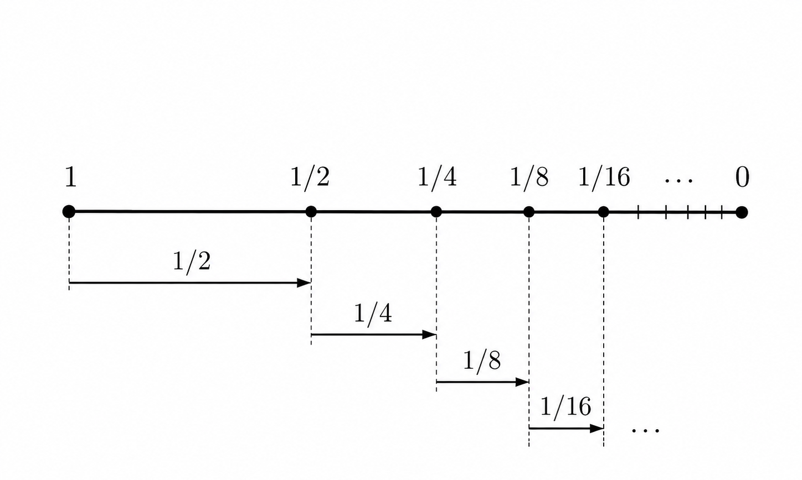

*Introductory Figure I.1 — The racecourse is subdivided into infinitely many successive portions. The goal is at $0$; the marked positions are the fractions of the course still to be covered. Original diagram.*

In this idealised description, infinitely many portions of the course must be traversed. Every portion takes a positive amount of time. Does this mean that the **total** time must necessarily be infinite?

This is the mathematical content of Zeno's question. It asks whether adding infinitely many positive quantities can ever produce a finite result. The modern answer is **yes**, although it depends on the sizes of the quantities being added.

### Constant speed: an infinite sum with a finite limit

Suppose the runner moves at a constant speed and needs $T>0$ minutes to cover the first half of the track. The next quarter takes half as long, the following eighth takes a quarter as long, and so forth. The times required for the successive portions are

$$
T,\quad\frac{T}{2},\quad\frac{T}{4},\quad\frac{T}{8},\quad\ldots,
\quad\frac{T}{2^{n-1}},\quad\ldots
$$

The proposed total running time is described symbolically by the **infinite series**

$$
T+\frac{T}{2}+\frac{T}{4}+\frac{T}{8}+\cdots.
$$

The difficulty is that ordinary addition, as initially understood, combines only finitely many numbers. We must therefore decide what it means to add infinitely many terms.

Begin by adding just the first $n$ terms. The resulting number is called the **$n$th partial sum**:

$$
S_n
=T+\frac{T}{2}+\frac{T}{4}+\cdots+\frac{T}{2^{n-1}}
=\sum_{k=1}^{n}\frac{T}{2^{k-1}}.
$$

The first few partial sums are

$$
\begin{aligned}
S_1&=T,\\
S_2&=T+\frac{T}{2}=\frac32T,\\
S_3&=T+\frac{T}{2}+\frac{T}{4}=\frac74T,\\
S_4&=T+\frac{T}{2}+\frac{T}{4}+\frac{T}{8}=\frac{15}{8}T.
\end{aligned}
$$

These expressions suggest the general formula

$$
\boxed{S_n=\left(2-\frac{1}{2^{n-1}}\right)T
=2T\left(1-\frac{1}{2^n}\right).}
$$

This can be checked by induction. For $n=1$, the right-hand side equals $T$. If it holds for some $n$, then

$$
\begin{aligned}
S_{n+1}
&=S_n+\frac{T}{2^n}\\
&=2T\left(1-\frac1{2^n}\right)+\frac{T}{2^n}\\
&=2T\left(1-\frac1{2^{n+1}}\right).
\end{aligned}
$$

Therefore the formula holds for every positive integer. Since the remaining term tends to zero,

$$
\lim_{n\to\infty}\frac{1}{2^n}=0,
$$

we obtain

$$
\boxed{\lim_{n\to\infty}S_n=2T.}
$$

In the language of infinite series, this is written

$$
\boxed{\sum_{k=1}^{\infty}\frac{T}{2^{k-1}}=2T.}
$$

The last equation does **not** mean that an infinite number of operations have been performed one by one and then finally completed. It means that the finite partial sums $S_n$ approach $2T$ as $n$ grows without bound.

Under the constant-speed assumption, the runner reaches the finish in a finite time: precisely twice the time required to reach the halfway point. Thus the mere presence of infinitely many subdivisions does not make the total duration infinite.

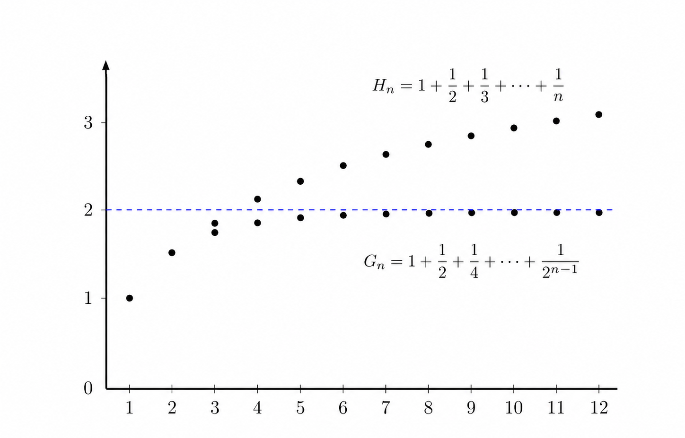

*Introductory Figure I.2 — The normalised geometric partial sums approach $2$, whereas the harmonic partial sums continue increasing. Original graph.*

### A different runner: an infinite sum that does not converge

Let us now modify a single assumption. Instead of travelling at a constant speed, suppose the runner slows down. Assume that the time needed to cross the successive halves of the remaining course is

$$
T,\quad\frac{T}{2},\quad\frac{T}{3},\quad\frac{T}{4},\quad\ldots,
\quad\frac{T}{n},\quad\ldots
$$

In particular, the segment from $2^{-(n-1)}$ to $2^{-n}$ now takes $T/n$ minutes. Its length is $2^{-n}$, so the runner's speed during that segment is

$$
v_n=\frac{2^{-n}}{T/n}=\frac{n}{2^nT},
$$

which becomes very small for large $n$.

The total elapsed time after $n$ portions is now

$$
S_n=T\left(1+\frac12+\frac13+\cdots+\frac1n\right)
=T\sum_{k=1}^{n}\frac1k.
$$

The expression in parentheses is the $n$th **harmonic partial sum**, often denoted by $H_n$. There is no simple closed formula analogous to the geometric one, but we can compare $H_n$ with an integral.

The function

$$
f(x)=\frac1x,\qquad x>0,
$$

is decreasing. Over each interval from $k$ to $k+1$, the rectangle of width $1$ and height $1/k$ lies on or above the graph. Hence

$$
\frac1k\geq\int_k^{k+1}\frac{dx}{x}.
$$

Adding these inequalities for $k=1,2,\ldots,n$ gives

$$
\begin{aligned}
1+\frac12+\frac13+\cdots+\frac1n
&\geq\int_1^{n+1}\frac{dx}{x}\\
&=\log(n+1).
\end{aligned}
$$

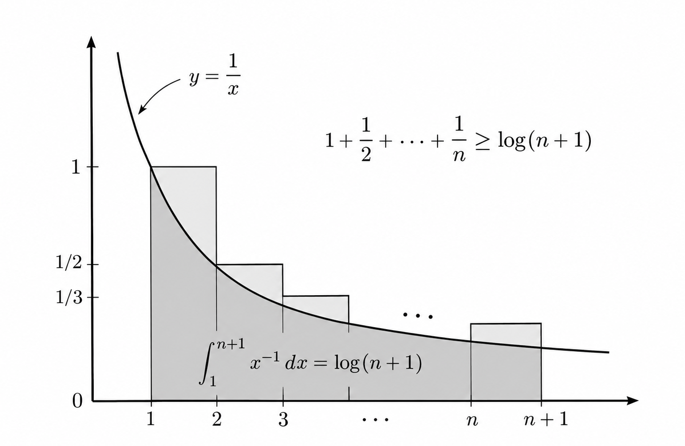

*Introductory Figure I.3 — The total area of the rectangles is the harmonic partial sum; it exceeds the shaded area under $1/x$. Original illustration.*

Therefore,

$$
\boxed{S_n\geq T\log(n+1).}
$$

Since

$$
\lim_{n\to\infty}\log(n+1)=+\infty,
$$

the elapsed times $S_n$ are unbounded:

$$
\lim_{n\to\infty}S_n=+\infty.
$$

In this second model, the runner does **not** reach the goal in finite time. The conclusion resembles Zeno's, but it arises because the runner's speed was deliberately chosen to decrease, **not** because infinitely many subdivisions by themselves prevent completion.

The difference between the two cases is fundamental:

| Running-time model | $n$th time interval | Behaviour of partial sums |
|---|---|---|
| Constant speed | $\displaystyle T/2^{n-1}$ | $\displaystyle S_n\to 2T$ — finite limit |
| Decreasing speed | $\displaystyle T/n$ | $\displaystyle S_n\to+\infty$ — no finite limit |

The first infinite series is **convergent**; the second is **divergent**.

### Why Zeno's question mattered to Analysis

The racecourse paradox shows why limits are essential. Writing infinitely many terms separated by plus signs is not sufficient to define a sum. We must examine the *sequence of finite partial sums* and determine whether that sequence approaches a finite number.

This distinction became clearer during the development of calculus in the seventeenth and eighteenth centuries. **Nicholas Mercator** and **William Brouncker** investigated infinite expressions related to logarithms; **Isaac Newton** extended the binomial formula into an infinite series; and **Leonhard Euler** used series extensively to connect many areas of mathematics.

For a nonnegative integer $m$, the ordinary binomial theorem is the finite identity

$$
(1+x)^m=\sum_{k=0}^{m}\binom{m}{k}x^k.
$$

For a general real exponent $r$, the corresponding infinite expansion takes the form

$$
(1+x)^r=\sum_{k=0}^{\infty}\binom{r}{k}x^k,
\qquad |x|<1,
$$

where

$$
\binom{r}{k}=\frac{r(r-1)\cdots(r-k+1)}{k!},
\qquad\binom{r}{0}=1.
$$

The infinite version raises questions that do not arise in the finite identity: for which values of $x$ does the series converge, and when may it be manipulated like an ordinary sum? Early mathematicians sometimes applied finite algebraic rules to infinite series without verifying that the operations were justified.

The demand for more rigorous arguments grew during the nineteenth century. **Carl Friedrich Gauss** gave a careful convergence study of a particular infinite series in 1812. **Augustin-Louis Cauchy**, notably in his *Cours d'analyse* (1821), made limits and convergence central to a systematic theory of Analysis.

The lesson is that **infinity is studied through finite quantities that depend on an index**. This leads naturally to the language of sequences.

---

## A First Look at Sequences

### Sequences and series are different objects

In everyday language, “sequence” and “series” may both suggest an ordered succession. In Mathematics, they refer to distinct objects.

A **sequence** consists of ordered terms. For example,

$$
a_1,a_2,a_3,\ldots,a_n,\ldots
$$

is a sequence of numbers. Every term has an integer index: we can speak of the first term, the second term and, in general, the $n$th term. The indexing continues indefinitely, so an infinite sequence has no final term.

An **infinite series**, by contrast, is the formal sum of the terms of a sequence:

$$
a_1+a_2+a_3+\cdots.
$$

To give this sum a rigorous meaning, we construct the sequence of partial sums

$$
S_n=\sum_{k=1}^{n}a_k
$$

and investigate whether $S_n$ has a finite limit. Zeno's two runners illustrate why that distinction matters.

### How a sequence is specified

The most convenient technical definition is that a sequence is a **function whose domain is the positive integers**:

$$
a:\mathbb N\longrightarrow\mathbb R,
\qquad a(n)=a_n.
$$

Sequences may also take complex values, in which case their codomain is $\mathbb C$. Now this is not the objective of this curriculum, but it is worth seeing an example at least (a proactive reader can have a look into the [complex analysis module]({{ '/pages/mathematics/complex_analysis/' | relative_url }})). Their defining feature is the index, not the particular way their terms are written down.

There are several common ways to specify a sequence:

**1. An explicit formula.** The harmonic sequence has

$$
a_n=\frac1n,
\qquad n\geq1,
$$

and starts as

$$
1,\quad\frac12,\quad\frac13,\quad\frac14,\quad\frac15,\quad\ldots
$$

**2. Different formulas for different indices.** For example, set

$$
a_{2n-1}=1,\qquad a_{2n}=2n^2,
\qquad n\geq1.
$$

The resulting terms are

$$
1,\ 2,\ 1,\ 8,\ 1,\ 18,\ 1,\ 32,\ 1,\ldots
$$

**3. A recurrence relation.** A recurrence defines later terms using earlier ones. The **Fibonacci sequence** is the classical example:

$$
a_1=a_2=1,
\qquad a_{n+1}=a_n+a_{n-1}\quad(n\geq2).
$$

Its first terms are

$$
1,\ 1,\ 2,\ 3,\ 5,\ 8,\ 13,\ 21,\ 34,\ldots
$$

This sequence is traditionally associated with **Leonardo of Pisa (Fibonacci)** and his problem about the reproduction of rabbits.

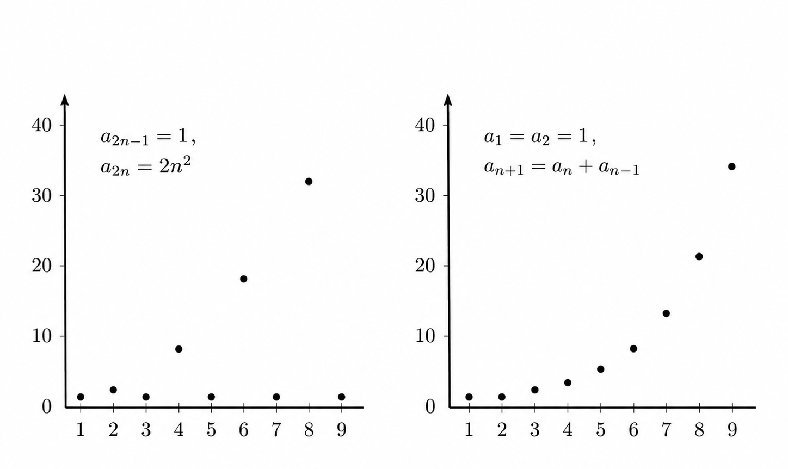

*Introductory Figure I.4 — A sequence may be defined by separate odd/even formulas or by a recurrence such as Fibonacci's. Original graphs.*

### Convergence, divergence and infinite limits

We will shortly give the precise definition of convergence in Definition 1.19. The basic idea is that a sequence converges to a **finite** number $L$ when its terms eventually lie as close to $L$ as we wish:

$$
\boxed{\forall\varepsilon>0\;\exists N_\varepsilon\in\mathbb N:
\quad n>N_\varepsilon\Longrightarrow|a_n-L|<\varepsilon.}
$$

We write

$$
\lim_{n\to\infty}a_n=L,
\qquad\text{or}\qquad a_n\longrightarrow L.
$$

A sequence with no finite limit is called **divergent**. Divergence does not necessarily mean tending to infinity. For example,

$$
a_n=(-1)^n
$$

alternates between $-1$ and $1$, whereas

$$
b_n=n
$$

increases without bound. Both are divergent, but for different reasons.

For a real sequence, writing

$$
a_n\longrightarrow+\infty
$$

means that for every real number $M$, all sufficiently late terms lie above $M$:

$$
\forall M\in\mathbb R\;\exists N\in\mathbb N:\quad
n>N\Longrightarrow a_n>M.
$$

Similarly, $a_n\to-\infty$ means the terms eventually lie below every real threshold. Neither case is called *convergent* in the finite-limit sense used in these notes.

### Complex-valued sequences

Suppose a sequence takes complex values and write

$$
z_n=u_n+iv_n,
\qquad L=\alpha+i\beta,
$$

where $u_n,v_n,\alpha,\beta$ are real. The sequence $(z_n)$ converges to $L$ **if and only if** its real and imaginary parts converge separately:

$$
\boxed{z_n\to\alpha+i\beta
\quad\Longleftrightarrow\quad
u_n\to\alpha\ \text{and}\ v_n\to\beta.}
$$

To see one direction, observe that

$$
|u_n-\alpha|\leq|z_n-L|,
\qquad |v_n-\beta|\leq|z_n-L|.
$$

Thus $z_n\to L$ implies that both component differences tend to zero. Conversely, the triangle inequality gives

$$
|z_n-L|
=|(u_n-\alpha)+i(v_n-\beta)|
\leq|u_n-\alpha|+|v_n-\beta|,
$$

so convergence of the two real sequences implies convergence of the complex sequence.

For example,

$$
z_n=\frac{1+i(-1)^n}{n}
$$

converges to $0$ in the complex plane, since both its real and imaginary parts approach zero.

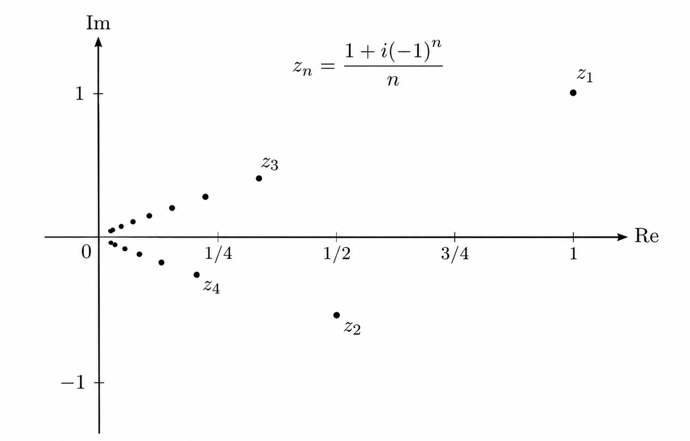

*Introductory Figure I.5 — The terms of a complex sequence alternately lie above and below the real axis while their distance to the origin tends to zero. Original graph.*

### Some benchmark limits

Several familiar sequences provide useful reference examples. For fixed real constants satisfying the conditions shown, we have

$$
\lim_{n\to\infty}\frac1{n^a}=0,
\qquad a>0,
$$

$$
\lim_{n\to\infty}x^n=0,
\qquad |x|<1,
$$

$$
\lim_{n\to\infty}n^{1/n}=1,
$$

$$
\lim_{n\to\infty}\left(1+\frac{a}{n}\right)^n=e^a,
\qquad a\in\mathbb R,
$$

and

$$
\lim_{n\to\infty}\frac{(\log n)^a}{n^b}=0,
\qquad a>0,\quad b>0.
$$

These limits can be established using familiar properties of real functions or proved directly from the sequence definition. They are particularly useful when analysing more complicated expressions.

---

## A First Look at Monotone Sequences

### Increasing, decreasing and bounded sequences

A real sequence $(a_n)_{n\in\mathbb N}$ is called **increasing** (more precisely, non-decreasing) if

$$
a_n\leq a_{n+1}\qquad\text{for every }n\geq1.
$$

It is **decreasing** (non-increasing) if

$$
a_n\geq a_{n+1}\qquad\text{for every }n\geq1.
$$

A sequence of either type is called **monotone**. The inequalities are strict when we say *strictly increasing* or *strictly decreasing*.

A sequence is **bounded** if there is a number $M>0$ such that

$$
|a_n|\leq M\qquad\text{for every }n\geq1.
$$

The definitions of upper and lower bounds are developed formally in Definition 1.30. Monotonicity alone does not guarantee that a sequence converges: an increasing sequence can grow without bound. Together, however, **monotonicity and boundedness give a powerful convergence criterion**.

### Monotone convergence theorem

**Theorem (preliminary).** A monotone sequence of real numbers converges to a finite limit **if and only if** it is bounded.

**Proof.** We first show why a bounded increasing sequence converges. Let $(a_n)$ be increasing and bounded above. By the completeness property of $\mathbb R$, the set of its terms has a least upper bound:

$$
L=\sup\{a_n:n\in\mathbb N\}.
$$

Therefore,

$$
a_n\leq L\qquad\text{for all }n\in\mathbb N.
$$

Fix any $\varepsilon>0$. Because $L-\varepsilon$ is **not** an upper bound of all the terms, there is some $N\in\mathbb N$ for which

$$
L-\varepsilon<a_N.
$$

Since the sequence is increasing, for every $n\geq N$,

$$
L-\varepsilon<a_N\leq a_n\leq L.
$$

Consequently,

$$
0\leq L-a_n<\varepsilon\qquad\text{for all }n\geq N,
$$

which means

$$
\boxed{\lim_{n\to\infty}a_n=L
=\sup\{a_n:n\in\mathbb N\}.}
$$

For a bounded **decreasing** sequence, the same argument uses the greatest lower bound, or infimum:

$$
\boxed{\lim_{n\to\infty}a_n
=\inf\{a_n:n\in\mathbb N\}.}
$$

The reverse implication is also true: a sequence that converges to a finite limit must be bounded (Theorem 1.31 below gives a complete proof). Together, these facts establish the criterion. $\square$

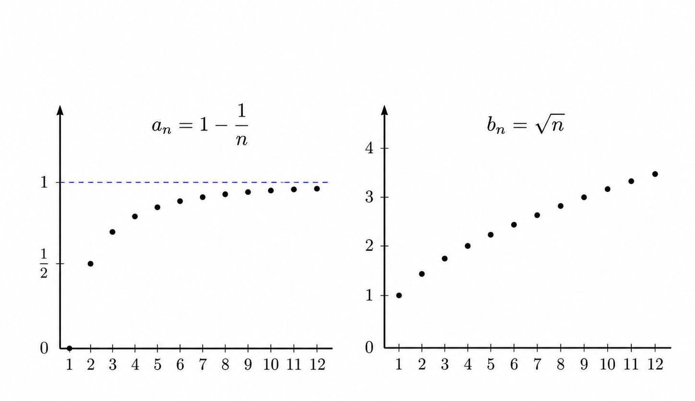

*Introductory Figure I.6 — The increasing sequence $1-1/n$ converges to its supremum $1$, whereas $\sqrt n$ increases without bound. Original graphs.*

For example, the sequence

$$
a_n=1-\frac1n
$$

is increasing and bounded above by $1$, so the theorem gives $a_n\to1$. The sequence

$$
b_n=\sqrt n
$$

is also increasing but unbounded, and therefore does not converge to a finite number.

Finally, monotonicity is a **sufficient**, not a necessary, condition when paired with boundedness: some convergent sequences oscillate around their limits, as we shall see in Example 1.17. The rigorous notion of convergence applies to all such sequences, whether monotone or not.

---

## 1.1 — Sequences, Convergence and Limits

Before diving into sequences, we would like to recall the very basic definition of a function, a paramount notion in Mathematics, and quintessential in developing the right analytical framework that we'd need later on.

### Definition 1.11 — Function

Consider two sets $A,B\subseteq\mathbb R$. A **function** $f$ from $A$ to $B$ maps each element of $A$ to one element of $B$. We use the notation

$$
f:A\longrightarrow B,
$$

and say that $f$ is defined on $A$, with values in $B$. If $f$ maps $x\in A$ to $y\in B$, we write $y=f(x)$.

### Example 1.12 — The Square Root Function

Let $A=B=\mathbb R$. We can define a function $f:\mathbb R^{+}\to\mathbb R$ by mapping every positive real number $x$ to its square root $\sqrt{x}$. In this case,

$$
f(x)=\sqrt{x}.
$$

### Example 1.13 — A Piecewise-Defined Function

Let $A=B=\mathbb R$. We can define a function $f:\mathbb R\to\mathbb R$ as follows:

$$
f(x)=
\begin{cases}
x, & \text{if }x\geq 0,\\[2pt]
x^3, & \text{if }x<0.
\end{cases}
$$

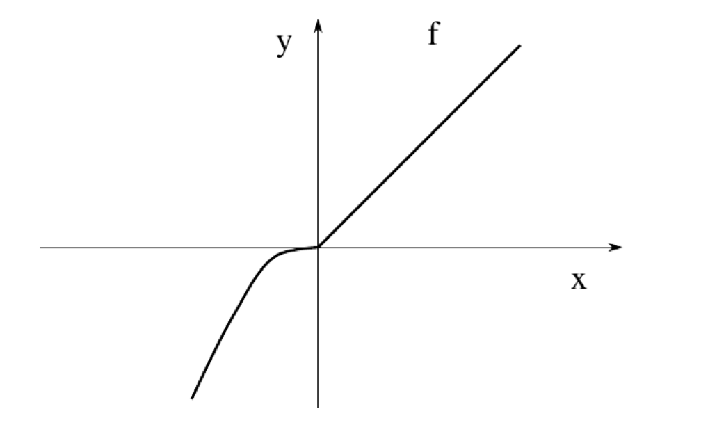

*Figure 1.1 — The function in Example 1.13 (source Figure 2.1).*

### Remark 1.14 — Functions on the Natural Numbers

In the special case $A=\mathbb N$, a function is also called a **sequence** (see Definition 1.15 below).

### Definition 1.15 — Sequence

A **sequence** with values (or terms) in $\mathbb R$ is a function

$$
a:\mathbb N\longrightarrow\mathbb R. \tag{1.11}
$$

We will usually write $a_n$ instead of $a(n)$, as is customary in the literature, and denote the sequence by

$$
(a_n)_{n\in\mathbb N}\qquad\text{or}\qquad(a_1,a_2,a_3,\ldots).
$$

In this chapter, we study in detail what happens to sequences when $n$ gets larger and larger. In particular, we are interested in sequences that approach a **limit value** $\alpha\in\mathbb R$ as $n$ increases.

To clarify what is meant by a “limit value”, we first give some examples and then formulate a rigorous mathematical definition of convergence.

### Example 1.16 — The Harmonic Sequence

If we want to divide a cake equally among $n$ people, then each person receives a fraction $1/n$ of the cake. This defines the **harmonic sequence**

$$
a_n=\frac1n.
$$

Its name comes from music: the numbers $1/2,1/3,\ldots$ are related to the overtones of a plucked string, which are called harmonics.

We are interested in understanding what happens to $a_n$ as the integer $n$ becomes larger and larger. That is, how large a fraction of the cake will each person receive if the number of people keeps increasing? We have

$$
a_1=1,\qquad a_2=0.5,\qquad a_4=0.25,\qquad a_5=0.2.
$$

If there are five people, each of them receives a slice that is only $0.2$ of the total cake. Our intuition tells us that if we divide a cake among a huge number of people, each of them will eventually receive only a very small slice.

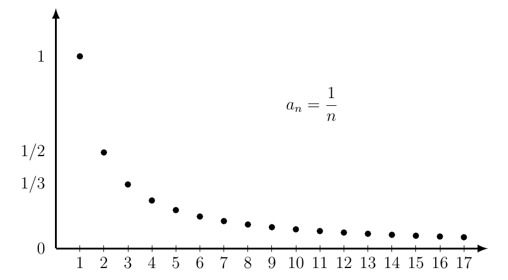

*Figure 1.2 — A pictorial description of the harmonic sequence (source Figure 2.2).*

Further calculations agree with this intuition. For instance,

$$
a_{1000}=0.001.
$$

If the number of people keeps increasing, the fraction of cake available to each person becomes closer and closer to $0$, as Figure 1.2 also suggests.

Let us now see another example.

### Example 1.17 — A Sequence Oscillating Around One

Let

$$
a_n=1+\frac{(-1)^n}{n}. \tag{1.12}
$$

We have

$$
a_1=0,\qquad a_2=\frac32,\qquad a_3=\frac23,\qquad a_4=\frac54,\qquad a_5=\frac45.
$$

As before, we are interested in the behaviour of $a_n$ as $n$ increases. Notice that $a_n$ is obtained by either adding $1/n$ to $1$ (when $n$ is even) or subtracting $1/n$ from $1$ (when $n$ is odd).

In Example 1.16 we saw that the harmonic sequence $1/n$ approaches the limit value $0$ as $n$ increases. It is therefore reasonable to expect that

$$
a_n=1+\frac{(-1)^n}{n}
$$

approaches the limit value $1$, as suggested by Figure 1.3.

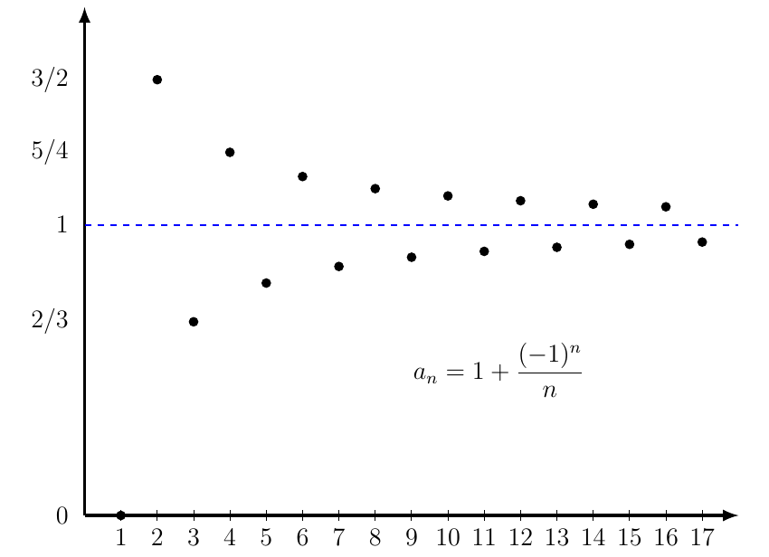

*Figure 1.3 — A pictorial description of the sequence in (1.12) (source Figure 2.3).*

From these last two examples, we have an intuitive idea of what the limit of a sequence should be. It seems natural to say that the limit of the harmonic sequence is $0$, whereas the limit of the sequence in Example 1.17 is $1$.

**How can we explain this rigorously?**

At first, the crucial point seems to be that $a_n$ gets closer and closer to the proposed limit as $n$ increases. We might therefore try the following definition:

> A sequence is said to converge to a limit when its distance from that limit becomes smaller and smaller as the index increases. In symbols:
>
> $$
> (a_n)_{n\in\mathbb N}\text{ converges to }\alpha
> \quad\Longleftrightarrow\quad
> |a_n-\alpha|\text{ becomes smaller and smaller as }n\text{ increases}.
> $$

There are two problems with this proposal. First, we have not clarified what “becomes smaller and smaller” means. Second, there are sequences that approach a limit although the distance to that limit does **not** decrease at every step, as the next example shows.

### Example 1.18 — Convergence Without Monotonically Decreasing Distance

Let $(a_n)_{n\in\mathbb N}$ be the sequence

$$
a_n=\frac12+\frac{1+(-1)^n}{n}. \tag{1.13}
$$

Its first six terms are

$$
a_1=\frac12,\quad a_2=\frac32,\quad a_3=\frac12,\quad
a_4=1,\quad a_5=\frac12,\quad a_6=\frac56.
$$

The behaviour of $(a_n)_{n\in\mathbb N}$ is illustrated in Figure 1.4.

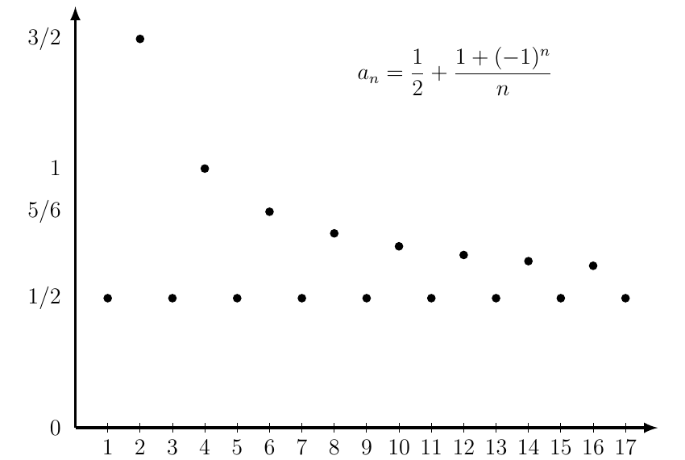

*Figure 1.4 — A pictorial description of the sequence in (1.13) (source Figure 2.4).*

In this case, it seems clear that as $n$ increases, $a_n$ approaches $1/2$. However, it is **not** true that the distance

$$
\left|a_n-\frac12\right|
$$

decreases as $n$ grows.

### Towards a Rigorous Definition of Convergence

To understand what all the preceding examples have in common, let us look more carefully at the sequence in **Example 1.17**, which approaches the limit value $1$.

Consider a band (or “stripe”) of fixed size around $1$. For instance, draw a band extending $0.3$ above and $0.3$ below $1$. The particular number $0.3$ is not important, as we will see. Figure 1.5 shows that all the terms $a_n$ corresponding to $n>3$ lie inside that band. In other words,

$$
n>3\quad\Longrightarrow\quad |a_n-1|<0.3. \tag{1.14}
$$

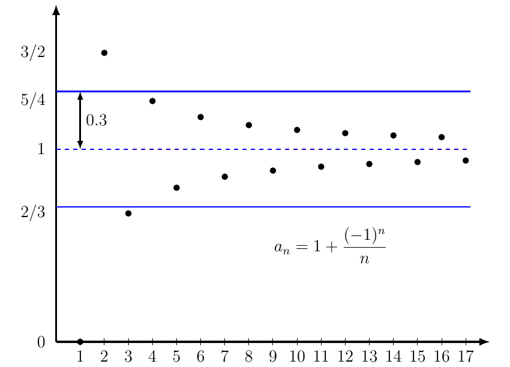

*Figure 1.5 — For the sequence in (1.12):*

$$
|a_n-1|<0.3\quad\text{whenever}\quad n>3.
$$

*(Source Figure 2.5.)*

Let us change the size of the band and see what happens. If we draw a band extending $0.18$ above and below the proposed limit $1$, we find that all terms of the sequence with $n>5$ lie inside it. Thus,

$$
n>5\quad\Longrightarrow\quad |a_n-1|<0.18. \tag{1.15}
$$

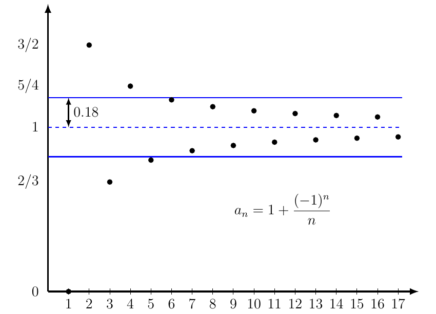

*Figure 1.6 — For the sequence in (1.12):*

$$
|a_n-1|<0.18\quad\text{whenever}\quad n>5.
$$

*(Source Figure 2.6.)*

If we drew bands of different sizes, the situation would always be the same: after a certain integer, depending on the width of the band, **all subsequent terms of the sequence lie inside that band**.

That is, if we fix a positive number $\varepsilon$ and draw a band of width $\varepsilon$ on either side of $1$, we can find an integer $N_\varepsilon$ such that

$$
n>N_\varepsilon\quad\Longrightarrow\quad |a_n-1|<\varepsilon.
$$

The same phenomenon occurs in the preceding examples. This suggests the following definition.

### Definition 1.19 — Convergent Sequence

Let $(a_n)_{n\in\mathbb N}$ be a sequence and let $\alpha\in\mathbb R$. We say that **$(a_n)_{n\in\mathbb N}$ converges to $\alpha$** if and only if

$$
\boxed{\forall\varepsilon>0\;\exists N_\varepsilon\in\mathbb N:\quad
n>N_\varepsilon\ \Longrightarrow\ |a_n-\alpha|<\varepsilon.} \tag{1.16}
$$

### Remark 1.20 — Equivalent Form of the Definition

Equivalently, $(a_n)_{n\in\mathbb N}$ converges to $\alpha$ if and only if

$$
\forall\varepsilon>0\;\exists N_\varepsilon\in\mathbb N:\quad
|a_n-\alpha|<\varepsilon\quad\text{for every }n>N_\varepsilon.
$$

### Remark 1.21 — Notation for Convergence

The following statements and notations are equivalent and commonly used in the literature:

1. $(a_n)_{n\in\mathbb N}$ converges to $\alpha$.
2. $\alpha$ is the limit of the sequence $(a_n)_{n\in\mathbb N}$.
3. $\displaystyle\lim_{n\to\infty}a_n=\alpha$.
4. $a_n\to\alpha$ as $n\to\infty$.
5. $\displaystyle a_n\xrightarrow[n\to\infty]{}\alpha$.

### Remark 1.22 — Two Choices of $N_\varepsilon$

For the sequence in (1.12), when $\varepsilon=0.3$ we found $N_{0.3}=3$ (see (1.14)). When $\varepsilon=0.18$, we found $N_{0.18}=5$ (see (1.15)).

### Remark 1.23 — Non-Uniqueness of $N_\varepsilon$

The number $N_\varepsilon\in\mathbb N$ appearing in the definition of a limit is **not unique**. Figure 1.6 makes this clear. With $\varepsilon=0.18$, we found that $N_{0.18}=5$. However, $5$ is merely the smallest possible choice. Any natural number greater than $5$ is also admissible as $N_{0.18}$.

### Example 1.24 — Proving the Limit of $n/(n+1)$

Show that

$$
\lim_{n\to\infty}\frac{n}{n+1}=1.
$$

In this case, we need to study the behaviour of the sequence

$$
a_n=\frac{n}{n+1},\qquad n\in\mathbb N.
$$

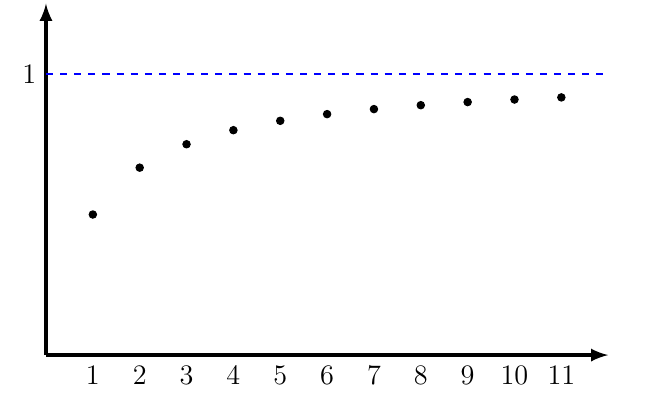

*Figure 1.7 — The behaviour of $n/(n+1)$ up to $n=11$ (source Figure 2.7).*

Figure 1.7 suggests that, as $n$ grows, the terms approach $1$. We now prove this rigorously.

**Proof.** Fix $\varepsilon>0$. We want to find $N_\varepsilon\in\mathbb N$ such that

$$
n>N_\varepsilon\quad\Longrightarrow\quad
\left|\frac{n}{n+1}-1\right|<\varepsilon. \tag{1.17}
$$

To find $N_\varepsilon$, we work with the inequality $\left|\frac n{n+1}-1\right|<\varepsilon$. We have

$$
\left|\frac{n}{n+1}-1\right|<\varepsilon
\quad\Longleftrightarrow\quad
\frac{1}{n+1}<\varepsilon
\quad\Longleftrightarrow\quad
n>\frac1\varepsilon-1. \tag{1.18}
$$

This almost gives the information we need. We want a **natural number** $N_\varepsilon$ satisfying (1.17), but $1/\varepsilon-1$ need not be a natural number. For example, this is the case when $\varepsilon=2/3$.

To avoid this issue, we use the **Archimedean property of $\mathbb R$**. It guarantees that there exists a $P\in\mathbb N$ such that

$$
P>\frac1\varepsilon-1. \tag{1.19}
$$

We now show that (1.17) holds with $N_\varepsilon=P$. Indeed,

$$
\begin{aligned}
n>P&\ \overset{(1.19)}{\Longrightarrow}\ n>\frac1\varepsilon-1\\
&\ \overset{(1.18)}{\Longleftrightarrow}\
\left|\frac{n}{n+1}-1\right|<\varepsilon.
\end{aligned}
$$

This is precisely (1.17). We have proved that for every $\varepsilon>0$ we can find a natural number $N_\varepsilon$ for which the implication holds. Therefore,

$$
\boxed{\frac{n}{n+1}\longrightarrow1\quad\text{as }n\to\infty.}
$$

### Remark 1.25 — Understanding the Previous Proof

Let us interpret the argument above. Its point is that the sequence $n/(n+1)$ can be **trapped** in a band centred at $1$, as narrow as we wish, provided we wait long enough.

For instance, choose $\varepsilon=1/4$. Repeating the calculations in (1.18), this time with $\varepsilon=1/4$, gives

$$
\left|\frac{n}{n+1}-1\right|<\frac14
\quad\Longleftrightarrow\quad n>3.
$$

Thus, whenever $n>3$, the distance from $n/(n+1)$ to $1$ is less than $1/4$, as Figure 1.8 illustrates.

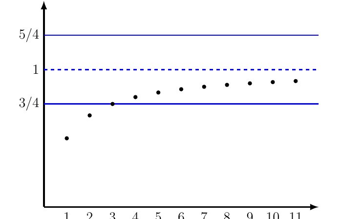

*Figure 1.8 — The sequence from Example 1.24 lies between:*

$$
\frac34\leq\frac{n}{n+1}\leq\frac54\quad\text{when}\quad n>3.
$$

*(Source Figure 2.8.)*

In proving (1.17), we established that this procedure works **regardless of the value of $\varepsilon$**: we can trap $n/(n+1)$ in a band centred at $1$ as small as we wish, as long as $n$ is large enough.

### Example 1.26 — The Harmonic Sequence Converges to Zero

Let us show that the harmonic sequence converges to $0$; that is,

$$
\lim_{n\to\infty}\frac1n=0.
$$

**Proof.** We use the definition of convergence. Fix $\varepsilon>0$. Our goal is to find an integer $N_\varepsilon$ such that

$$
n>N_\varepsilon\quad\Longrightarrow\quad
\left|\frac1n-0\right|<\varepsilon. \tag{1.20}
$$

To this end, look carefully at the inequality on the right and observe that

$$
\left|\frac1n-0\right|<\varepsilon
\quad\Longleftrightarrow\quad n>\frac1\varepsilon. \tag{1.21}
$$

This tells us that if $n>1/\varepsilon$, then the distance between $1/n$ and $0$ is less than $\varepsilon$. However, we require a **natural number** $N_\varepsilon$ for which (1.20) holds. We do not know that $1/\varepsilon\in\mathbb N$; for instance, this fails when $\varepsilon=5/6$. We therefore use the Archimedean property of $\mathbb R$ again.

By this property, there exists $Q\in\mathbb N$ such that

$$
Q>\frac1\varepsilon. \tag{1.22}
$$

Let us show that choosing any $p\in\mathbb N$ with $p\geq Q$ as $N_\varepsilon$ makes (1.20) true. Indeed,

$$
\begin{aligned}
n>p&\ \Longrightarrow\ n>Q\\
&\ \overset{(1.22)}{\Longrightarrow}\ n>\frac1\varepsilon\\
&\ \overset{(1.21)}{\Longleftrightarrow}\
\left|\frac1n-0\right|<\varepsilon.
\end{aligned}
$$

This gives (1.20), and hence the required convergence.

### Example 1.27 — Constant Sequence

Let $c\in\mathbb R$ be fixed, and consider the sequence

$$
a_n=c\qquad\forall n\in\mathbb N. \tag{1.23}
$$

Then,

$$
\lim_{n\to\infty}a_n=c. \tag{1.24}
$$

**Proof.** As before, fix $\varepsilon>0$ and seek an integer $N_\varepsilon$ such that

$$
n>N_\varepsilon\quad\Longrightarrow\quad |a_n-c|<\varepsilon.
$$

Since $a_n=c$ for every $n\in\mathbb N$, we need $N_\varepsilon\in\mathbb N$ such that

$$
n>N_\varepsilon\quad\Longrightarrow\quad 0<\varepsilon. \tag{1.25}
$$

But $0<\varepsilon$ is always true because $\varepsilon$ is positive. Thus **any** natural number $N_\varepsilon$ satisfies (1.25), and (1.24) follows.

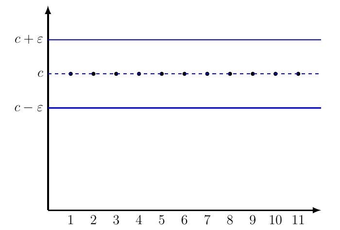

*Figure 1.9 — For a constant sequence:*

$$
|a_n-c|<\varepsilon\quad\text{for every}\quad n\quad\text{and every}\quad\varepsilon>0.
$$

*Hence any integer can serve as the threshold (source Figure 2.9).*

### Example 1.28 — A Sequence That Is Eventually Constant

Let $(a_n)_{n\in\mathbb N}$ be the sequence

$$
a_n=
\begin{cases}
2, & \text{if }n=1,2,3,4,5,6,7,\\[2pt]
5, & \text{if }n\geq8.
\end{cases}
$$

We want to prove that

$$
\lim_{n\to\infty}a_n=5.
$$

**Proof.** Fix $\varepsilon>0$. We need to show that we can find an integer $N_\varepsilon\in\mathbb N$ satisfying

$$
n>N_\varepsilon\quad\Longrightarrow\quad|a_n-5|<\varepsilon. \tag{1.26}
$$

Consider the expression $|a_n-5|$. We have

$$
|a_n-5|=
\begin{cases}
3, & \text{if }n=1,2,3,4,5,6,7,\\[2pt]
0, & \text{if }n\geq8.
\end{cases}
$$

We wish to find a natural number $N_\varepsilon$ beyond which the expression is smaller than $\varepsilon$. The choice $N_\varepsilon=7$ (or any larger integer) certainly works, because the expression equals $0$ when $n>7$. Specifically,

$$
n>7\quad\Longrightarrow\quad |a_n-5|=0<\varepsilon.
$$

For every $\varepsilon>0$, the choice $N_\varepsilon=7$ therefore satisfies (1.26). Consequently, $a_n\to5$.

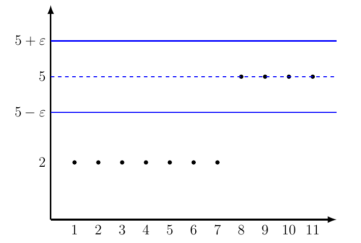

*Figure 1.10 — For the sequence in Example 1.28:*

$$
|a_n-5|<\varepsilon\quad\text{whenever}\quad n>7.
$$

*(Source Figure 2.10.)*

### Theorem 1.29 — Uniqueness of the Limit

**The limit of a convergent sequence is unique.**

**Proof.** Suppose that $(a_n)_{n\in\mathbb N}$ is a sequence such that

$$
\lim_{n\to\infty}a_n=\alpha
$$

for some $\alpha\in\mathbb R$. By Definition 1.19, this means

$$
\forall\eta>0\;\exists C_\eta\in\mathbb N:\quad
n>C_\eta\Longrightarrow|a_n-\alpha|<\eta. \tag{1.27}
$$

Assume, towards a contradiction, that there is also a real number $\beta\neq\alpha$ such that

$$
\lim_{n\to\infty}a_n=\beta.
$$

Again, by Definition 1.19,

$$
\forall\varepsilon>0\;\exists D_\varepsilon\in\mathbb N:\quad
n>D_\varepsilon\Longrightarrow|a_n-\beta|<\varepsilon. \tag{1.28}
$$

Choose

$$
\eta=\frac{|\alpha-\beta|}{2}>0.
$$

By (1.27), there exists $C_{|\alpha-\beta|/2}\in\mathbb N$ such that

$$
n>C_{|\alpha-\beta|/2}
\quad\Longrightarrow\quad
|a_n-\alpha|<\frac{|\alpha-\beta|}{2}. \tag{1.29}
$$

At the same time, putting

$$
\varepsilon=\frac{|\alpha-\beta|}{2}>0,
\qquad
D_{|\alpha-\beta|/2}\in\mathbb N
$$

in (1.28), we obtain this natural number with

$$
n>D_{|\alpha-\beta|/2}
\quad\Longrightarrow\quad
|a_n-\beta|<\frac{|\alpha-\beta|}{2}. \tag{1.30}
$$

Set

$$
R=\max\left\{C_{|\alpha-\beta|/2},D_{|\alpha-\beta|/2}\right\}.
$$

For any $n>R$, both (1.29) and (1.30) apply. By the triangle inequality,

$$
\begin{aligned}
|\alpha-\beta|
&\leq|\alpha-a_n|+|a_n-\beta|\\
&<\left(\frac12+\frac12\right)|\alpha-\beta|\\
&=|\alpha-\beta|,
\end{aligned}
$$

which is a contradiction. $\square$

### Definition 1.30 — Bounded Sequence

Let $(a_n)_{n\in\mathbb N}$ be a sequence.

We say that $(a_n)_{n\in\mathbb N}$ is **bounded from above** if there exists $K\in\mathbb R$ such that

$$
a_n\leq K\qquad\forall n\in\mathbb N. \tag{1.31}
$$

In this case, $K$ is called an **upper bound** of $(a_n)_{n\in\mathbb N}$.

Similarly, the sequence is **bounded from below** if there exists $K\in\mathbb R$ such that

$$
a_n\geq K\qquad\forall n\in\mathbb N.
$$

In this case, $K$ is a **lower bound** of the sequence.

Finally, $(a_n)_{n\in\mathbb N}$ is **bounded** if it is bounded both above and below. Equivalently, $(a_n)_{n\in\mathbb N}$ is bounded if there exists an $M>0$ with

$$
|a_n|\leq M\qquad\forall n\in\mathbb N. \tag{1.32}
$$

### Theorem 1.31 — Every Convergent Sequence Is Bounded

**A convergent sequence is bounded.**

**Proof.** Let $(a_n)_{n\in\mathbb N}$ be a sequence such that

$$
\lim_{n\to\infty}a_n=\alpha
$$

for some $\alpha\in\mathbb R$. Choose a number $\varepsilon>0$; for example, $\varepsilon=5$ (although any positive number would work).

By Definition 1.19, there exists $N_5\in\mathbb N$ such that

$$
|a_n-\alpha|<5\qquad\text{for every }n>N_5. \tag{1.33}
$$

Set

$$
M=\max\left\{|a_1|,|a_2|,\ldots,|a_{N_5}|,|\alpha|+5\right\}.
$$

By the definition of $M$,

$$
|a_n|\leq M\qquad\text{for every }n\leq N_5. \tag{1.34}
$$

Furthermore, by the triangle inequality and (1.33),

$$
|a_n|\leq|\alpha|+|a_n-\alpha|<|\alpha|+5\leq M
\qquad\text{for every }n>N_5. \tag{1.35}
$$

Combining (1.34) and (1.35), we obtain $|a_n|\leq M$ for every $n\in\mathbb N$, which is (1.32). The proof works in exactly the same way for any $\varepsilon>0$ in place of $5$. $\square$

### Remark 1.32 — The Converse Is False

The converse of Theorem 1.31 is not true. Indeed, the sequence

$$
a_n=(-1)^n,\qquad n\in\mathbb N,
$$

is bounded but does **not** converge (the original lecture discusses this again in its Example 3.3).

We will see later that every bounded sequence admits at least one **convergent subsequence** (the Bolzano–Weierstrass theorem).

---

## 1.2 — Properties of Sequences

In this section, we discuss how limits can be calculated **without always using the definition of convergence directly**. We then prove the comparison principle. We start by showing that taking limits is compatible with sums and products.

### Theorem 1.33 — Algebra of Sequences

Let $(a_n)_{n\in\mathbb N}$ and $(b_n)_{n\in\mathbb N}$ be two sequences, and let $\alpha,\beta\in\mathbb R$. Assume that

$$
\lim_{n\to\infty}a_n=\alpha
\qquad\text{and}\qquad
\lim_{n\to\infty}b_n=\beta.
$$

Then:

1. **Sum**

   $$
   \lim_{n\to\infty}(a_n+b_n)=\alpha+\beta.
   $$

2. **Product**

   $$
   \lim_{n\to\infty}(a_nb_n)=\alpha\beta.
   $$

3. **Scalar multiplication**: for every $\lambda\in\mathbb R$,

   $$
   \lim_{n\to\infty}(\lambda a_n)=\lambda\alpha.
   $$

4. **Quotient**: if $b_n\neq0$ for every $n\in\mathbb N$ and $\beta\neq0$, then

   $$
   \lim_{n\to\infty}\frac{a_n}{b_n}=\frac{\alpha}{\beta}.
   $$

**Proof.** By the definition of a limit, for every $\eta>0$ and every $\theta>0$, there exist $C_\eta,D_\theta\in\mathbb N$ such that

$$
n>C_\eta\quad\Longrightarrow\quad|a_n-\alpha|<\eta, \tag{1.36}
$$

and

$$
n>D_\theta\quad\Longrightarrow\quad|b_n-\beta|<\theta. \tag{1.37}
$$

**Part 1 — Sum.** Let $\varepsilon>0$. We want to find $N_\varepsilon\in\mathbb N$ such that

$$
n>N_\varepsilon\quad\Longrightarrow\quad
|(a_n+b_n)-(\alpha+\beta)|<\varepsilon. \tag{1.38}
$$

Choose $\eta=\theta=\varepsilon/2$ in (1.36) and (1.37). Then there exist $C_{\varepsilon/2},D_{\varepsilon/2}\in\mathbb N$ satisfying

$$
n>C_{\varepsilon/2}\quad\Longrightarrow\quad|a_n-\alpha|<\frac\varepsilon2,
$$

and

$$
n>D_{\varepsilon/2}\quad\Longrightarrow\quad|b_n-\beta|<\frac\varepsilon2.
$$

Define

$$
R:=\max\{C_{\varepsilon/2},D_{\varepsilon/2}\}.
$$

We claim that choosing any $N_\varepsilon\in\mathbb N$ with $N_\varepsilon\geq R$ makes (1.38) true. Indeed, if $n>N_\varepsilon\geq R$, the triangle inequality gives

$$
\begin{aligned}
|(a_n+b_n)-(\alpha+\beta)|
&\leq|a_n-\alpha|+|b_n-\beta|\\
&<\frac\varepsilon2+\frac\varepsilon2
=\varepsilon.
\end{aligned}
$$

This is (1.38).

**Part 2 — Product.** Let $\varepsilon>0$. We seek $N_\varepsilon\in\mathbb N$ such that

$$
n>N_\varepsilon\quad\Longrightarrow\quad
|a_nb_n-\alpha\beta|<\varepsilon. \tag{1.39}
$$

Since $(a_n)_{n\in\mathbb N}$ converges, it is bounded by Theorem 1.31. Consequently, there exists $K>0$ such that

$$
|a_n|\leq K\qquad\text{for every }n\in\mathbb N.
$$

Define

$$
L:=\max\{K,|\beta|\},
$$

and choose $\eta=\theta=\varepsilon/(2L)$ in (1.36) and (1.37). Since $L>0$, this is a valid choice. We obtain $C_{\varepsilon/(2L)},D_{\varepsilon/(2L)}\in\mathbb N$ such that

$$
n>C_{\varepsilon/(2L)}\quad\Longrightarrow\quad
|a_n-\alpha|<\frac{\varepsilon}{2L},
$$

and

$$
n>D_{\varepsilon/(2L)}\quad\Longrightarrow\quad
|b_n-\beta|<\frac{\varepsilon}{2L}.
$$

Set

$$
Q:=\max\{C_{\varepsilon/(2L)},D_{\varepsilon/(2L)}\}.
$$

We claim that any $N_\varepsilon\geq Q$ works in (1.39). Let $n>N_\varepsilon\geq Q$. Inserting and subtracting $a_n\beta$ and using the triangle inequality, we get

$$
\begin{aligned}
|a_nb_n-\alpha\beta|
&=|a_nb_n-a_n\beta+a_n\beta-\alpha\beta|\\
&\leq|a_n|\,|b_n-\beta|+|\beta|\,|a_n-\alpha|\\
&<K\frac{\varepsilon}{2L}+|\beta|\frac{\varepsilon}{2L}\\
&\leq L\frac{\varepsilon}{2L}+L\frac{\varepsilon}{2L}\\
&=\varepsilon.
\end{aligned}
$$

Thus (1.39) is proved.

**Part 3 — Scalar multiplication.** This follows directly from Part 2 by taking $(b_n)_{n\in\mathbb N}$ to be the constant sequence

$$
b_n=\lambda\qquad\text{for all }n\in\mathbb N,
$$

and recalling Example 1.27.

**Part 4 — Quotient.** It is enough to prove that

$$
\lim_{n\to\infty}\frac1{b_n}=\frac1\beta. \tag{1.40}
$$

Indeed, once (1.40) is established, the product rule from Part 2 yields

$$
\lim_{n\to\infty}\frac{a_n}{b_n}
=\lim_{n\to\infty}\left(a_n\cdot\frac1{b_n}\right)
=\alpha\cdot\frac1\beta
=\frac\alpha\beta.
$$

We now prove (1.40). Given $\varepsilon>0$, we want to find $N_\varepsilon\in\mathbb N$ with

$$
n>N_\varepsilon\quad\Longrightarrow\quad
\left|\frac1{b_n}-\frac1\beta\right|<\varepsilon. \tag{1.41}
$$

Choose $\theta=|\beta|/2$, which is strictly positive since $\beta\neq0$. By (1.37), there exists $D_{|\beta|/2}\in\mathbb N$ such that

$$
n>D_{|\beta|/2}\quad\Longrightarrow\quad
|b_n-\beta|<\frac{|\beta|}{2}.
$$

By the reverse triangle inequality, for every $n>D_{|\beta|/2}$,

$$
|\beta|-|b_n|
\leq\big||b_n|-|\beta|\big|
\leq|b_n-\beta|
<\frac{|\beta|}{2}.
$$

In particular,

$$
|b_n|>\frac{|\beta|}{2}>0
\qquad\text{for every }n>D_{|\beta|/2}. \tag{1.42}
$$

Apply (1.37) once more, this time with $\theta=\varepsilon|\beta|^2/2$. There exists $D_{\varepsilon|\beta|^2/2}\in\mathbb N$ for which

$$
n>D_{\varepsilon|\beta|^2/2}
\quad\Longrightarrow\quad
|b_n-\beta|<\frac{\varepsilon|\beta|^2}{2}. \tag{1.43}
$$

Define

$$
Q:=\max\{D_{|\beta|/2},D_{\varepsilon|\beta|^2/2}\}.
$$

We claim that the implication (1.41) holds with $N_\varepsilon=Q$. By (1.42) and (1.43), if $n>Q$ then

$$
\begin{aligned}
\left|\frac1{b_n}-\frac1\beta\right|
&=\left|\frac{\beta-b_n}{\beta b_n}\right|\\
&=\frac{|b_n-\beta|}{|\beta|\,|b_n|}\\
&<\frac{2}{|\beta|^2}|b_n-\beta|\\
&<\frac{2}{|\beta|^2}\cdot\frac{\varepsilon|\beta|^2}{2}\\
&=\varepsilon.
\end{aligned}
$$

This proves (1.40), and hence the quotient rule. $\square$

### Theorem 1.34 — Comparison Principle

Let $(a_n)_{n\in\mathbb N}$ and $(b_n)_{n\in\mathbb N}$ be two **convergent** sequences. Then

$$
\boxed{a_n\leq b_n\quad\text{for every }n\in\mathbb N
\quad\Longrightarrow\quad
\lim_{n\to\infty}a_n\leq\lim_{n\to\infty}b_n.}
$$

**Proof.** Write

$$
\alpha:=\lim_{n\to\infty}a_n,
\qquad
\beta:=\lim_{n\to\infty}b_n.
$$

By the definition of convergence, these statements mean that

$$
\forall\varepsilon>0\;\exists C_\varepsilon\in\mathbb N:\quad
|a_n-\alpha|<\varepsilon\quad\text{for every }n>C_\varepsilon, \tag{1.44}
$$

and

$$
\forall\eta>0\;\exists D_\eta\in\mathbb N:\quad
|b_n-\beta|<\eta\quad\text{for every }n>D_\eta. \tag{1.45}
$$

Suppose, for a contradiction, that

$$
\alpha>\beta. \tag{1.46}
$$

Choose

$$
\varepsilon=\eta=\frac{\alpha-\beta}{2}.
$$

By (1.46), both parameters are strictly positive. Equations (1.44) and (1.45) give us $C_{(\alpha-\beta)/2},D_{(\alpha-\beta)/2}\in\mathbb N$ satisfying

$$
n>C_{(\alpha-\beta)/2}
\quad\Longrightarrow\quad
|a_n-\alpha|<\frac{\alpha-\beta}{2},
$$

and

$$
n>D_{(\alpha-\beta)/2}
\quad\Longrightarrow\quad
|b_n-\beta|<\frac{\alpha-\beta}{2}.
$$

By the definition of absolute value (equivalently, $|x|<\delta\iff-\delta<x<\delta$), we can rewrite these as

$$
n>C_{(\alpha-\beta)/2}
\quad\Longrightarrow\quad
\alpha-\frac{\alpha-\beta}{2}<a_n<\alpha+\frac{\alpha-\beta}{2}, \tag{1.47}
$$

and

$$
n>D_{(\alpha-\beta)/2}
\quad\Longrightarrow\quad
\beta-\frac{\alpha-\beta}{2}<b_n<\beta+\frac{\alpha-\beta}{2}. \tag{1.48}
$$

Set

$$
Q:=\max\left\{C_{(\alpha-\beta)/2},D_{(\alpha-\beta)/2}\right\}. \tag{1.49}
$$

By (1.47), (1.48) and (1.49), for every $n>Q$,

$$
b_n
<\beta+\frac{\alpha-\beta}{2}
=\frac{\alpha+\beta}{2}
=\alpha-\frac{\alpha-\beta}{2}
<a_n.
$$

This contradicts the assumption $a_n\leq b_n$ for every $n\in\mathbb N$. Therefore $\alpha\leq\beta$. $\square$

### Remark 1.35 — Strict Inequalities Need Not Be Preserved

The comparison principle does **not** generally hold with strict inequality. In other words,

$$
a_n<b_n\quad\text{for every }n
\quad\not\Longrightarrow\quad
\lim_{n\to\infty}a_n<\lim_{n\to\infty}b_n.
$$

Indeed, consider the sequences

$$
a_n=0,\qquad b_n=\frac1n.
$$

We have $a_n<b_n$ for every $n\in\mathbb N$, but

$$
\lim_{n\to\infty}a_n
=\lim_{n\to\infty}b_n
=0.
$$

We conclude the chapter with an important theorem.

### Theorem 1.36 — Squeeze Theorem

Let $(a_n)_{n\in\mathbb N}$, $(b_n)_{n\in\mathbb N}$ and $(c_n)_{n\in\mathbb N}$ be sequences with real values, and let $\alpha\in\mathbb R$. Assume that

$$
a_n\leq b_n\leq c_n\qquad\text{for every }n\in\mathbb N,
$$

and

$$
\lim_{n\to\infty}a_n
=\lim_{n\to\infty}c_n
=\alpha.
$$

Then $(b_n)_{n\in\mathbb N}$ converges, and

$$
\boxed{\lim_{n\to\infty}b_n=\alpha.}
$$

**Proof (included in the source, although not covered in class).** Let $\varepsilon>0$. We look for $C_\varepsilon\in\mathbb N$ such that

$$
n>C_\varepsilon\quad\Longrightarrow\quad|b_n-\alpha|<\varepsilon.
$$

Since $a_n\to\alpha$ and $c_n\to\alpha$, there exist $D_\varepsilon,F_\varepsilon\in\mathbb N$ such that

$$
n>D_\varepsilon\quad\Longrightarrow\quad
\alpha-\varepsilon<a_n<\alpha+\varepsilon,
$$

and

$$
n>F_\varepsilon\quad\Longrightarrow\quad
\alpha-\varepsilon<c_n<\alpha+\varepsilon.
$$

Set $M:=\max\{D_\varepsilon,F_\varepsilon\}$. We show that we can choose $C_\varepsilon=M$. Indeed,

$$
n>M\quad\Longrightarrow\quad
\alpha-\varepsilon<a_n\leq b_n\leq c_n<\alpha+\varepsilon.
$$

Thus,

$$
n>M\quad\Longrightarrow\quad
\alpha-\varepsilon<b_n<\alpha+\varepsilon,
$$

which is equivalent to $|b_n-\alpha|<\varepsilon$. This proves $b_n\to\alpha$. $\square$

---

## 1.3 — Closing Remarks

We have taken a brief journey through sequences and the notion of convergence, beginning with **Zeno's paradox**, which illustrates how questions about infinity and motion naturally lead to the mathematical concept of a limit. From this historical motivation, we developed a rigorous understanding of convergence, explored fundamental examples, and established some of its most important properties, including the uniqueness of limits, boundedness, algebraic rules, and comparison principles.

Along the way, we also encountered **monotone sequences** and saw how the completeness of the real numbers provides a powerful criterion for convergence.

These ideas form some of the cornerstones of Real Analysis. Although our exploration has only begun, they provide the foundations for studying more advanced concepts, from infinite series and continuity to the broader theory of limits.

After all, understanding infinity begins with understanding what it means to approach something without necessarily reaching it!

---

## Supporting material

- [Exercises]({{ '/pages/mathematics/real_analysis/02-sequences-and-series/01-convergence-and-limits-of-sequences/exercises/' | relative_url }})
- [Worked solutions]({{ '/pages/mathematics/real_analysis/02-sequences-and-series/01-convergence-and-limits-of-sequences/solutions/' | relative_url }})
- [References]({{ '/pages/mathematics/real_analysis/02-sequences-and-series/01-convergence-and-limits-of-sequences/references/' | relative_url }})

## Subchapter navigation

Previous: this is the first subchapter

[Back to Chapter 2: Sequences and Series]({{ '/pages/mathematics/real_analysis/02-sequences-and-series/' | relative_url }})

[Next: 2.2 - Divergent Sequences and Infinite Limits]({{ '/pages/mathematics/real_analysis/02-sequences-and-series/02-divergent-sequences-and-infinite-limits/' | relative_url }})

</article>

