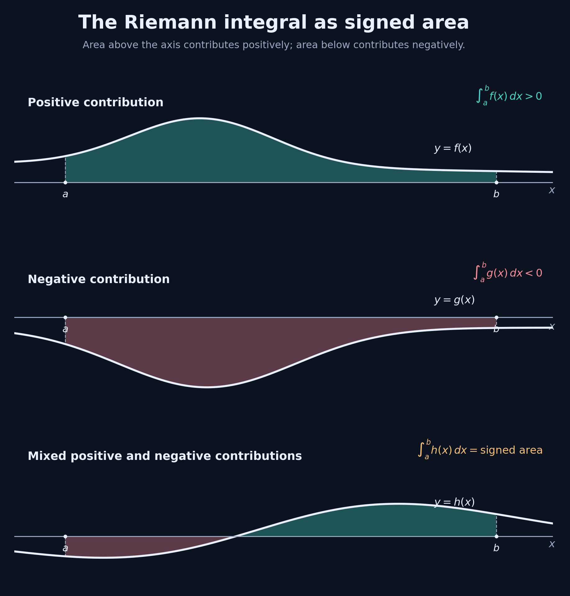
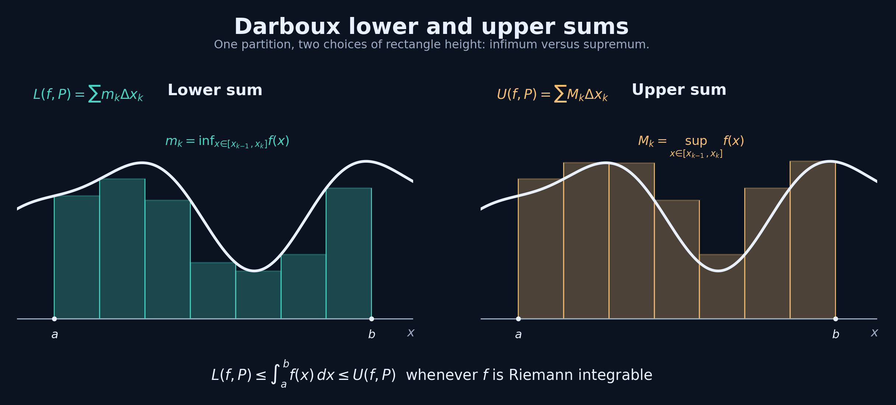

---
layout: default
title: "5.1: Riemann Integral and Darboux Sums"
permalink: /pages/mathematics/real_analysis/05-integral-calculus/01-riemann-integral-and-darboux-sums/
---

  <a class="back" href="{{ '/pages/mathematics/real_analysis/05-integral-calculus/' | relative_url }}">Chapter 5: Integral Calculus</a>
  
Mathematics / Real Analysis / 5.1

  <h1>5.1: Riemann Integral and Darboux Sums</h1>
  
Placeholder notes for Riemann Integral and Darboux Sums.

<article class="article" markdown="1">

# The Riemann Integral and Darboux Sums

## Introduction

In this chapter we introduce the **Riemann integral**

$$
\int_a^b f(x)\,dx
$$

as the signed area under the curve (or graph) of $f$ from $x=a$ to $x=b$. The Riemann integral encompasses the usual notion of an integral encountered at school. However, its precise mathematical definition allows us to integrate functions that are not continuous and that cannot be integrated using the elementary methods previously learned.

## 1.11 — Lower and Upper Darboux Sums of a Function with Respect to a Partition

We want to define the Riemann integral

$$
\int_a^b f(x)\,dx
$$

as the **signed area** under the graph of $f$ from $x=a$ to $x=b$. The following illustrations show a positive area, a negative area, and an area with portions of both signs.

*Figure 1.11.1 — Positive area under $f$, negative area under $g$, and area of both signs under $h$, each taken from $x=a$ to $x=b$.*

To approximate the area under a curve, we partition the interval $[a,b]$ and approximate the area by rectangles. We will define this construction rigorously once the necessary notation has been introduced.

We begin with **bounded functions**, whose values do not become arbitrarily large or arbitrarily small. Next, we introduce a **partition**: a collection of points

$$
P:=\{x_0,x_1,\ldots,x_{n-1},x_n\}\subseteq[a,b]
$$

satisfying

$$
a=x_0<x_1<x_2<\cdots<x_{k-1}<x_k<\cdots<x_{n-1}<x_n=b.
$$

The term *partition* reflects the fact that the points subdivide $[a,b]$ into the intervals

$$
[x_0,x_1]=[a,x_1],\quad [x_1,x_2],\quad\ldots,\quad
[x_{k-1},x_k],\quad\ldots,\quad[x_{n-1},x_n]=[x_{n-1},b].
$$

To approximate the area under the graph of a function $f$, we construct a rectangle over every subinterval $[x_{k-1},x_k]$. The sum of the signed areas of these rectangles gives an approximation to the area under the graph. By shrinking the widths of the subintervals, we obtain increasingly accurate approximations; this idea will lead to the Riemann integral.

### Definition 1.11.1 — Bounded function

A function $f:[a,b]\to\mathbb R$ is called **bounded** if there exist $m,M\in\mathbb R$ such that

$$
m\leq f(x)\leq M\qquad\text{for all }x\in[a,b].
$$

Equivalently, $f:[a,b]\to\mathbb R$ is bounded if there exists $K\in\mathbb R$ such that

$$
|f(x)|\leq K\qquad\text{for all }x\in[a,b].
$$

The set of bounded functions $f:[a,b]\to\mathbb R$ is denoted by

$$
\mathcal B([a,b]).
$$

### Definition 1.11.2 — Partition, width, and refinement

1. A **partition** $P=\{x_0,\ldots,x_n\}$ of an interval $[a,b]$ is a finite set of points satisfying

   $$
   a=x_0<x_1<\cdots<x_{n-1}<x_n=b.
   $$

   The set of all partitions of $[a,b]$ is denoted by $\mathcal P([a,b])$.

2. The **width** (or *mesh*) of a partition $P$ is

   $$
   w(P):=\max_{k=1,\ldots,n}(x_k-x_{k-1}).
   $$

3. Let $P$ and $Q$ be two partitions of the same interval $[a,b]$. We say that $Q$ is a **refinement** of $P$ if

   $$
   P\subseteq Q.
   $$

### Example 1.11.3 — Examples of partitions of $[0,1]$

**(a)** Let

$$
P=\left\{0,\frac13,1\right\},\qquad
Q=\left\{0,\frac13,\frac12,1\right\}.
$$

Here $Q$ is a refinement of $P$, and

$$
w(P)=\frac23,\qquad w(Q)=\frac12.
$$

**(b)** Let

$$
P=\left\{0,\frac13,1\right\},\qquad
Q=\left\{0,\frac14,\frac13,1\right\}.
$$

Here too $Q$ is a refinement of $P$, but

$$
w(P)=\frac23,\qquad w(Q)=\frac23.
$$

**(c)** An example in which neither partition refines the other is

$$
P=\left\{0,\frac13,1\right\},\qquad
Q=\left\{0,\frac12,1\right\}.
$$

In this case,

$$
w(P)=\frac23,\qquad w(Q)=\frac12.
$$

**(d)** For

$$
P=\left\{0,\frac13,1\right\},\qquad
Q=\left\{0,\frac12,1\right\},
$$

their union

$$
P\cup Q=\left\{0,\frac13,\frac12,1\right\}
$$

is a refinement of **both** $P$ and $Q$. More generally, the union $P\cup Q$ is always a common refinement of $P$ and $Q$.

**(e)** An equally spaced partition of $[0,1]$ into $n$ subintervals is

$$
P_n=\left\{0,\frac1n,\frac2n,\ldots,\frac{n-1}{n},1\right\}.
$$

For any interval $[a,b]$, the partition into $n$ equally spaced subintervals is

$$
P_n:=\left\{x_k:=a+k\frac{b-a}{n}:k=0,1,2,\ldots,n\right\}.
$$

### Lemma 1.11.4 — Partition width decreases under refinement

If $P,Q\in\mathcal P([a,b])$ and $P\subseteq Q$, then

$$
w(P)\geq w(Q).
$$

**Proof.** Since $Q$ contains all the points of $P$ and possibly additional ones, each subinterval of $Q$ is contained in a subinterval of $P$. Therefore the greatest length of a subinterval of $Q$ is no greater than the greatest length of a subinterval of $P$. Thus $w(P)\geq w(Q)$. $\square$

To specify the height of the rectangular approximation over each subinterval $[x_{k-1},x_k]$, we need the notions of the **infimum** and **supremum**, which are familiar from introductory analysis.

### Definition 1.11.5 — Infimum

Let $X\subseteq\mathbb R$ be a nonempty set. A number $\alpha$ is called the **infimum** of $X$, denoted $\alpha=\inf X$, if

1. $\alpha\leq x$ for all $x\in X$;
2. for every $\varepsilon>0$, there exists $x\in X$ such that $x<\alpha+\varepsilon$.

In other words, the infimum is the **greatest lower bound**.

### Definition 1.11.6 — Supremum

Let $X\subseteq\mathbb R$ be a nonempty set. A number $\beta$ is called the **supremum** of $X$, denoted $\beta=\sup X$, if

1. $\beta\geq x$ for all $x\in X$;
2. for every $\varepsilon>0$, there exists $x\in X$ such that $x>\beta-\varepsilon$.

In other words, the supremum is the **least upper bound**.

The **completeness axiom** of the real numbers ensures that every nonempty bounded subset of $\mathbb R$ has an infimum and a supremum.

### Example 1.11.7 — Infimum and supremum of $(-1,1]$

Find the infimum and supremum of

$$
X=\{x\in\mathbb R:-1<x\leq1\}=(-1,1].
$$

**Solution.** We claim that

$$
\inf X=-1,\qquad \sup X=1.
$$

**Proof that $\inf(-1,1]=-1$.**

1. From the definition of $(-1,1]$, we have $-1\leq x$ for every $x\in(-1,1]$.
2. Let $\varepsilon>0$ be arbitrary. We must find $x\in(-1,1]$ with $x<-1+\varepsilon$. The first attempt $x=-1+\varepsilon/2$ may fail for large $\varepsilon$, since that value can lie outside $(-1,1]$. Instead, choose

   $$
   x:=\min\left\{-1+\frac{\varepsilon}{2},\,0\right\}.
   $$

   This guarantees that $x\in(-1,1]$, while

   $$
   x=\min\left\{-1+\frac{\varepsilon}{2},0\right\}
   \leq-1+\frac{\varepsilon}{2}<-1+\varepsilon.
   $$

**Proof that $\sup(-1,1]=1$.**

1. Again, the definition of $(-1,1]$ gives $x\leq1$ for every $x\in(-1,1]$.
2. Let $\varepsilon>0$ be arbitrary. We can take $x=1\in(-1,1]$, which satisfies

   $$
   x=1>1-\varepsilon.
   $$

Consequently,

$$
\boxed{\inf(-1,1]=-1,\qquad\sup(-1,1]=1.}
$$

$\square$

### Remark 1.11.8 — The infimum or supremum need not belong to the set

By arguments analogous to those in Example 1.11.7, each of the intervals $[a,b]$, $(a,b)$, $(a,b]$, and $[a,b)$ has infimum $a$ and supremum $b$. Therefore the infimum or supremum of a set $X\subseteq\mathbb R$ **may or may not be an element of $X$**.

### Example 1.11.9 — Infimum and supremum of $\{1/n:n\in\mathbb N\}$

Determine the infimum and supremum of

$$
X:=\left\{\frac1n:n\in\mathbb N\right\}
=\left\{1,\frac12,\frac13,\ldots,\frac1n,\frac1{n+1},\ldots\right\}.
$$

**Solution.** We claim that $\inf X=0$ and $\sup X=1$.

**Proof that $\inf X=0$.**

1. Clearly $0<1/n$ for every $n\in\mathbb N$.
2. Let $\varepsilon>0$ be arbitrary. By choosing $m\in\mathbb N$ sufficiently large, we ensure that

   $$
   \frac1m<0+\varepsilon=\varepsilon.
   $$

   The number $x=1/m$ therefore belongs to $X$ and satisfies $x<0+\varepsilon$.

**Proof that $\sup X=1$.**

1. Clearly $x\leq1$ for all $x\in X$.
2. For any $\varepsilon>0$, take $x=1$. Then $x\in X$ and $x>1-\varepsilon$.

Hence

$$
\boxed{\inf X=0,\qquad\sup X=1.}
$$

$\square$

We can now introduce approximations to the area under the graph of a bounded function $f$ by rectangles. Over each subinterval $[x_{k-1},x_k]$, the largest rectangle that lies below the graph is determined by the infimum of $f$ there. Adding these signed rectangular areas gives the **lower sum**. The smallest rectangle that lies above the graph is determined by the supremum of $f$ there; adding those signed rectangular areas gives the **upper sum**. The construction is illustrated below.

*Figure 1.11.2 — Lower Darboux sum $\mathcal{L}(f,P)$ (left) and upper Darboux sum $\mathcal{U}(f,P)$ (right), constructed on the same partition $P$.*

### Definition 1.11.10 — Lower and upper Darboux sums

Let $f\in\mathcal B([a,b])$, and let $P=\{x_0,\ldots,x_n\}\in\mathcal P([a,b])$. The **lower sum** of $f$ with respect to $P$ is

$$
\boxed{\mathcal{L}(f,P):=\sum_{k=1}^{n}\left(\inf_{x\in[x_{k-1},x_k]}f(x)\right)(x_k-x_{k-1}).}
$$

The **upper sum** of $f$ with respect to $P$ is

$$
\boxed{\mathcal{U}(f,P):=\sum_{k=1}^{n}\left(\sup_{x\in[x_{k-1},x_k]}f(x)\right)(x_k-x_{k-1}).}
$$

**Note.** Since $f\in\mathcal B([a,b])$, the set $\{f(x):x\in[c,d]\}$ is bounded for every $a\leq c<d\leq b$. Thus the quantities

$$
\inf_{x\in[c,d]}f(x):=\inf\{f(x):x\in[c,d]\},
\qquad
\sup_{x\in[c,d]}f(x):=\sup\{f(x):x\in[c,d]\}
$$

exist and are finite. In particular, both

$$
\inf_{x\in[x_{k-1},x_k]}f(x)
\qquad\text{and}\qquad
\sup_{x\in[x_{k-1},x_k]}f(x)
$$

are finite. With the abbreviations

$$
m_k(f):=\inf_{x\in[x_{k-1},x_k]}f(x),
\qquad
M_k(f):=\sup_{x\in[x_{k-1},x_k]}f(x),
$$

the sums take the simpler form

$$
\boxed{\mathcal{L}(f,P)=\sum_{k=1}^{n}m_k(f)(x_k-x_{k-1}),\qquad
\mathcal{U}(f,P)=\sum_{k=1}^{n}M_k(f)(x_k-x_{k-1}).}
$$

We now work through several examples.

### Example 1.11.11 — The lower and upper sums usually differ

Let $f:[7,11]\to\mathbb R$ be defined by

$$
f(x):=\begin{cases}
2,&\text{if }x\text{ is rational},\\
5,&\text{if }x\text{ is irrational}.
\end{cases}
$$

Let $P$ be an arbitrary partition of $[7,11]$. Find $\mathcal{L}(f,P)$ and $\mathcal{U}(f,P)$.

**Solution.** Let $P=\{x_0,\ldots,x_n\}$. Every nondegenerate interval $[x_{k-1},x_k]$ contains both rational and irrational numbers. Consequently,

$$
\inf_{x\in[x_{k-1},x_k]}f(x)=2,
\qquad
\sup_{x\in[x_{k-1},x_k]}f(x)=5.
$$

Hence

$$
\begin{aligned}
\mathcal{L}(f,P)
&=\sum_{k=1}^{n}\left(\inf_{x\in[x_{k-1},x_k]}f(x)\right)(x_k-x_{k-1})\\
&=2\sum_{k=1}^{n}(x_k-x_{k-1})\\
&=2(11-7)=\boxed{8},
\end{aligned}
$$

and

$$
\begin{aligned}
\mathcal{U}(f,P)
&=\sum_{k=1}^{n}\left(\sup_{x\in[x_{k-1},x_k]}f(x)\right)(x_k-x_{k-1})\\
&=5\sum_{k=1}^{n}(x_k-x_{k-1})\\
&=5(11-7)=\boxed{20}.
\end{aligned}
$$

Thus the lower and upper sums are independent of the partition in this example, yet their values are different. $\square$

### Example 1.11.12 — A bounded function with a discontinuity

Let $f:[1,2]\to\mathbb R$ be defined by

$$
f(x):=\begin{cases}
0,&x\neq\sqrt2,\\
1,&x=\sqrt2.
\end{cases}
$$

For $n\in\mathbb N$, partition $[1,2]$ into $n$ subintervals of equal length:

$$
P_n=\left\{1,1+\frac1n,\ldots,1+\frac{n-1}{n},2\right\}
=\left\{1+\frac{k}{n}:k=0,1,\ldots,n\right\},
$$

with $w(P_n)=1/n$. Find $\mathcal{L}(f,P_n)$ and $\mathcal{U}(f,P_n)$.

**Solution.** Since $f(x)=0$ at every point other than $\sqrt2$, we have

$$
\begin{aligned}
\mathcal{L}(f,P_n)
&=\sum_{k=1}^{n}\left(\inf_{x\in[1+(k-1)/n,\,1+k/n]}f(x)\right)\frac1n\\
&=\sum_{k=1}^{n}0\cdot\frac1n=\boxed{0}.
\end{aligned}
$$

Because $\sqrt2$ is irrational, it cannot equal one of the rational partition points $1+k/n$. Therefore there is exactly one index $j\in\{1,\ldots,n\}$ such that

$$
\sqrt2\in\left[1+\frac{j-1}{n},\,1+\frac{j}{n}\right].
$$

The supremum of $f$ on that interval is $1$; on every other subinterval it is $0$. Thus

$$
\begin{aligned}
\mathcal{U}(f,P_n)
&=\sum_{k=1}^{n}\left(\sup_{x\in[1+(k-1)/n,\,1+k/n]}f(x)\right)\frac1n\\
&=\left(\sup_{x\in[1+(j-1)/n,\,1+j/n]}f(x)\right)\frac1n
+\sum_{\substack{k=1\\k\neq j}}^{n}
\left(\sup_{x\in[1+(k-1)/n,\,1+k/n]}f(x)\right)\frac1n\\
&=1\cdot\frac1n+0=\boxed{\frac1n}.
\end{aligned}
$$

We therefore observe that

$$
\mathcal{U}(f,P_n)=\frac1n\longrightarrow0=\mathcal{L}(f,P_n)
\qquad\text{as }n\to\infty.
$$

$\square$

### Example 1.11.13 — A piecewise constant function

Let $f:[0,2]\to\mathbb R$ be defined by

$$
f(x):=\begin{cases}
0,&0\leq x\leq1,\\
7,&1<x\leq2.
\end{cases}
$$

For $n\in\mathbb N$, let $P_{2n}$ be the equally spaced partition of $[0,2]$ into $2n$ subintervals:

$$
P_{2n}:=\left\{0,\frac1n,\ldots,\frac{2n-1}{n},2\right\}
=\left\{\frac{k}{n}:k=0,1,\ldots,2n\right\}.
$$

Find $\mathcal{L}(f,P_{2n})$ and $\mathcal{U}(f,P_{2n})$.

**Solution.** On each subinterval, the infimum is

$$
\inf_{x\in[(k-1)/n,\,k/n]}f(x)=
\begin{cases}
0,&1\leq k\leq n+1,\\
7,&n+2\leq k\leq2n,
\end{cases}
$$

whereas the supremum is

$$
\sup_{x\in[(k-1)/n,\,k/n]}f(x)=
\begin{cases}
0,&1\leq k\leq n,\\
7,&n+1\leq k\leq2n.
\end{cases}
$$

Therefore

$$
\begin{aligned}
\mathcal{L}(f,P_{2n})
&=\sum_{k=1}^{2n}\left(\inf_{x\in[(k-1)/n,\,k/n]}f(x)\right)\frac1n\\
&=\frac1n\sum_{k=n+2}^{2n}7
=\frac7n\sum_{k=n+2}^{2n}1
=\boxed{7\frac{n-1}{n}},
\end{aligned}
$$

and

$$
\begin{aligned}
\mathcal{U}(f,P_{2n})
&=\sum_{k=1}^{2n}\left(\sup_{x\in[(k-1)/n,\,k/n]}f(x)\right)\frac1n\\
&=\frac1n\sum_{k=n+1}^{2n}7
=\frac7n\sum_{k=n+1}^{2n}1
=\boxed{7}.
\end{aligned}
$$

It follows that

$$
\lim_{n\to\infty}\mathcal{L}(f,P_{2n})
=\lim_{n\to\infty}7\frac{n-1}{n}
=7
=\lim_{n\to\infty}\mathcal{U}(f,P_{2n}).
$$

$\square$

We now derive bounds for the lower and upper sums.

### Lemma 1.11.14 — Bounds on lower and upper sums I

Let $f\in\mathcal B([a,b])$ and $P\in\mathcal P([a,b])$. Then

$$
\boxed{\left(\inf_{x\in[a,b]}f(x)\right)(b-a)
\leq \mathcal{L}(f,P)\leq \mathcal{U}(f,P)
\leq\left(\sup_{x\in[a,b]}f(x)\right)(b-a).}
\tag{1.11.1}
$$

**Proof.** Write $P=\{x_0,x_1,\ldots,x_n\}$. For each subinterval $[x_{k-1},x_k]$,

$$
\inf_{x\in[a,b]}f(x)
\leq\inf_{x\in[x_{k-1},x_k]}f(x)
\leq\sup_{x\in[x_{k-1},x_k]}f(x)
\leq\sup_{x\in[a,b]}f(x).
$$

Multiplying by the nonnegative number $x_k-x_{k-1}$ and summing over $k=1,\ldots,n$ gives (1.11.1). $\square$

### Remark 1.11.15 — Lower and upper sums are bounded

Lemma 1.11.14 shows that the sets

$$
\{\mathcal{L}(f,P):P\in\mathcal P([a,b])\}
\quad\text{and}\quad
\{\mathcal{U}(f,P):P\in\mathcal P([a,b])\}
$$

are bounded subsets of $\mathbb R$.

The next lemma is a technical result needed for the proof of Lemma 1.11.17. Its proof is given at the end of this chapter. It is less important to memorize the technical estimate itself than to understand Lemmas 1.11.14 and 1.11.17.

### Lemma 1.11.16 — Bounds on lower and upper sums II

Let $f\in\mathcal B([a,b])$ and $P,Q\in\mathcal P([a,b])$, where $P\subseteq Q$ and $Q$ has $j$ more points than $P$. Let $K$ be an upper bound for $|f|$ on $[a,b]$. Then

$$
\boxed{\mathcal{L}(f,Q)\geq \mathcal{L}(f,P)\geq \mathcal{L}(f,Q)-2jK\,w(P),}
\tag{1.11.2}
$$

$$
\boxed{\mathcal{U}(f,Q)\leq \mathcal{U}(f,P)\leq \mathcal{U}(f,Q)+2jK\,w(P).}
\tag{1.11.3}
$$

### Lemma 1.11.17 — Every lower sum is at most every upper sum

Let $f\in\mathcal B([a,b])$. For **any two** partitions $P,Q\in\mathcal P([a,b])$,

$$
\boxed{\mathcal{L}(f,P)\leq \mathcal{U}(f,Q).}
\tag{1.11.4}
$$

**Proof.** Consider the common refinement $P\cup Q$. By Lemma 1.11.14,

$$
\mathcal{L}(f,P\cup Q)\leq \mathcal{U}(f,P\cup Q).
\tag{1.11.5}
$$

Since $P\cup Q$ refines both $P$ and $Q$, Lemma 1.11.16 gives

$$
\mathcal{L}(f,P\cup Q)\geq \mathcal{L}(f,P),
\qquad
\mathcal{U}(f,P\cup Q)\leq \mathcal{U}(f,Q).
\tag{1.11.6}
$$

Combining (1.11.5) and (1.11.6), we obtain

$$
\mathcal{L}(f,P)\leq \mathcal{L}(f,P\cup Q)
\leq \mathcal{U}(f,P\cup Q)\leq \mathcal{U}(f,Q),
$$

which proves (1.11.4). $\square$

## 1.12 — Lower and Upper Riemann Integrals

After these preparations, we can define the lower and upper Riemann integrals of a bounded function. The intuitive idea is to make the subintervals in a partition smaller and smaller and then take a limit. Although the formal definition below does not express this process directly, we will see later that it agrees with the idea of shrinking the partition width to zero.

### Definition 1.12.18 — Lower and upper Riemann integrals

Let $f\in\mathcal B([a,b])$. The **lower Riemann integral** of $f$ over $[a,b]$ is

$$
\boxed{\underline{\int_a^b}f(x)\,dx
:=\sup\{\mathcal{L}(f,P):P\in\mathcal P([a,b])\}.}
\tag{1.12.1}
$$

The **upper Riemann integral** of $f$ over $[a,b]$ is

$$
\boxed{\overline{\int_a^b}f(x)\,dx
:=\inf\{\mathcal{U}(f,P):P\in\mathcal P([a,b])\}.}
\tag{1.12.2}
$$

### Remark 1.12.19 — Lower and upper Riemann integrals are finite

From Lemmas 1.11.14 and 1.11.17, for every $P,Q\in\mathcal P([a,b])$ and every $f\in\mathcal B([a,b])$,

$$
\left(\inf_{x\in[a,b]}f(x)\right)(b-a)
\leq \mathcal{L}(f,P)\leq \mathcal{U}(f,Q)
\leq\left(\sup_{x\in[a,b]}f(x)\right)(b-a).
$$

It follows that both the supremum in (1.12.1) and the infimum in (1.12.2) exist and are finite. Thus the lower and upper Riemann integrals are well-defined for every bounded $f$.

We can now define the Riemann integral and specify when a function is Riemann integrable. A bounded function is Riemann integrable precisely when its lower and upper Riemann integrals have the same value; this common value is its integral.

### Definition 1.12.20 — Riemann integrability and the Riemann integral

We say that $f\in\mathcal B([a,b])$ is **Riemann integrable** over $[a,b]$ if

$$
\underline{\int_a^b}f(x)\,dx
=\overline{\int_a^b}f(x)\,dx.
$$

In that case, the common value is the **Riemann integral** of $f$ over $[a,b]$, denoted by

$$
\boxed{\int_a^b f(x)\,dx
:=\underline{\int_a^b}f(x)\,dx
=\overline{\int_a^b}f(x)\,dx.}
$$

The set of Riemann integrable functions on $[a,b]$ is denoted by

$$
\mathcal R([a,b]).
$$

Lemma 1.11.17 established that the lower sum for any partition does not exceed the upper sum for any other partition. This implies that the lower Riemann integral never exceeds the upper Riemann integral.

### Lemma 1.12.21 — Lower Riemann integral $\leq$ upper Riemann integral

Let $f\in\mathcal B([a,b])$. Then

$$
\boxed{\underline{\int_a^b}f(x)\,dx
\leq\overline{\int_a^b}f(x)\,dx.}
$$

**Proof.** Lemma 1.11.17 tells us that for every pair of partitions $P,Q\in\mathcal P([a,b])$,

$$
\mathcal{L}(f,P)\leq \mathcal{U}(f,Q).
$$

Taking the supremum over $P$ on the left and the infimum over $Q$ on the right yields

$$
\sup\{\mathcal{L}(f,P):P\in\mathcal P([a,b])\}
\leq\inf\{\mathcal{U}(f,Q):Q\in\mathcal P([a,b])\}.
$$

By Definition 1.12.18, this is precisely the stated inequality. $\square$

We consider several examples.

### Example 1.12.22 — Constant functions are Riemann integrable

Every constant function $f:[a,b]\to\mathbb R$, $f(x):=C$ for some fixed $C\in\mathbb R$, is Riemann integrable, and

$$
\boxed{\int_a^b f(x)\,dx=C(b-a).}
\tag{1.12.3}
$$

**Proof.** On every subinterval $[c,d]\subseteq[a,b]$,

$$
\inf_{x\in[c,d]}f(x)=\sup_{x\in[c,d]}f(x)=C.
$$

Therefore, for every $P\in\mathcal P([a,b])$,

$$
\begin{aligned}
\mathcal{L}(f,P)&=\sum_{k=1}^{n}C(x_k-x_{k-1})=C(b-a),\\
\mathcal{U}(f,P)&=\sum_{k=1}^{n}C(x_k-x_{k-1})=C(b-a).
\end{aligned}
$$

It follows that the lower and upper Riemann integrals coincide, and hence (1.12.3) holds. $\square$

### Example 1.12.23 — An everywhere discontinuous function

Show that the function $f:[7,11]\to\mathbb R$ defined by

$$
f(x):=\begin{cases}
2,&\text{if }x\text{ is rational},\\
5,&\text{if }x\text{ is irrational}
\end{cases}
$$

is **not** Riemann integrable over $[7,11]$.

**Solution.** Example 1.11.11 showed that for every $P\in\mathcal P([7,11])$,

$$
\mathcal{L}(f,P)=8,\qquad \mathcal{U}(f,P)=20.
$$

Thus

$$
\underline{\int_7^{11}}f(x)\,dx
=\sup\{\mathcal{L}(f,P):P\in\mathcal P([7,11])\}=8,
$$

while

$$
\overline{\int_7^{11}}f(x)\,dx
=\inf\{\mathcal{U}(f,P):P\in\mathcal P([7,11])\}=20.
$$

As $8\neq20$, the lower and upper integrals do not coincide. Therefore $f$ is not Riemann integrable over $[7,11]$. $\square$

### Example 1.12.24 — A bounded function with a single discontinuity

The function $f:[1,2]\to\mathbb R$ from Example 1.11.12,

$$
f(x):=\begin{cases}
0,&x\neq\sqrt2,\\
1,&x=\sqrt2,
\end{cases}
$$

is Riemann integrable and has integral

$$
\boxed{\int_1^2 f(x)\,dx=0.}
$$

We will establish this formally in the next chapter. $\square$

## 1.13 — Proof of the Technical Refinement Lemma

We now give the proof of Lemma 1.11.16, which was deferred earlier.

### Proof of Lemma 1.11.16

The proof proceeds by induction on $j$, the number of additional points in $Q$. We explain the argument for **lower sums**; the argument for upper sums is analogous.

**(1) The case $j=0$.** Here $P=Q$, so the inequalities are equalities.

**(2) The case $j=1$.** The refinement $Q$ has exactly one additional point compared with $P$. Write

$$
P=\{x_0,x_1,\ldots,x_n\},
\qquad Q=P\cup\{q\},
$$

and suppose that $q$ lies strictly inside one interval $[x_{k-1},x_k]$ of $P$.

Only the contributions associated with this interval can differ between the two lower sums. Denote the contribution to $\mathcal{L}(f,P)$ by

$$
S_1:=\left(\inf_{x\in[x_{k-1},x_k]}f(x)\right)(x_k-x_{k-1}).
$$

The two corresponding contributions to $\mathcal{L}(f,Q)$ are

$$
S_2:=\left(\inf_{x\in[x_{k-1},q]}f(x)\right)(q-x_{k-1}),
$$

$$
S_3:=\left(\inf_{x\in[q,x_k]}f(x)\right)(x_k-q).
$$

Since

$$
\inf_{x\in[x_{k-1},q]}f(x)
\geq\inf_{x\in[x_{k-1},x_k]}f(x),
$$

and

$$
\inf_{x\in[q,x_k]}f(x)
\geq\inf_{x\in[x_{k-1},x_k]}f(x),
$$

we obtain $S_2+S_3\geq S_1$. This proves the first inequality in (1.11.2) when $j=1$:

$$
\mathcal{L}(f,Q)\geq \mathcal{L}(f,P).
$$

For the second inequality, we need to show that

$$
S_1\geq S_2+S_3-2K\,w(P).
$$

The infimum of $f$ over the entire interval $[x_{k-1},x_k]$ equals the infimum on at least one of its two parts. Thus either

$$
\inf_{x\in[x_{k-1},x_k]}f(x)
=\inf_{x\in[x_{k-1},q]}f(x)
$$

or

$$
\inf_{x\in[x_{k-1},x_k]}f(x)
=\inf_{x\in[q,x_k]}f(x).
\tag{1.13.1}
$$

Without loss of generality, assume that (1.13.1) holds. Then

$$
\begin{aligned}
\inf_{x\in[x_{k-1},x_k]}f(x)
&=\inf_{x\in[x_{k-1},q]}f(x)
+\inf_{x\in[x_{k-1},x_k]}f(x)
-\inf_{x\in[x_{k-1},q]}f(x)\\
&\geq\inf_{x\in[x_{k-1},q]}f(x)
-2\sup_{x\in[a,b]}|f(x)|\\
&\geq\inf_{x\in[x_{k-1},q]}f(x)-2K.
\end{aligned}
\tag{1.13.2}
$$

Using (1.13.1) and (1.13.2),

$$
\begin{aligned}
S_1
&=\left(\inf_{x\in[x_{k-1},x_k]}f(x)\right)(x_k-x_{k-1})\\[2pt]
&=\left(\inf_{x\in[x_{k-1},x_k]}f(x)\right)(q-x_{k-1})
+\left(\inf_{x\in[x_{k-1},x_k]}f(x)\right)(x_k-q)\\[2pt]
&\geq\left(\inf_{x\in[x_{k-1},q]}f(x)-2K\right)(q-x_{k-1})
+\left(\inf_{x\in[q,x_k]}f(x)\right)(x_k-q)\\[2pt]
&\geq\left(\inf_{x\in[x_{k-1},q]}f(x)\right)(q-x_{k-1})
-2K\,w(P)
+\left(\inf_{x\in[q,x_k]}f(x)\right)(x_k-q)\\[2pt]
&=S_2-2K\,w(P)+S_3.
\end{aligned}
$$

In the penultimate line we used

$$
q-x_{k-1}\leq w(Q)\leq w(P),
$$

because $Q$ is a refinement of $P$. This establishes the required estimate when $j=1$.

**(3) The case $j>1$.** Proceed by induction. Assume the statement is known when a refinement has $j-1$ more points than the original partition. If $Q$ refines $P$ with $j$ additional points, select any $u\in Q\setminus P$ and define

$$
\widetilde Q:=Q\setminus\{u\}.
$$

The partition $\widetilde Q$ refines $P$ and has $j-1$ more points than $P$. Apply the induction hypothesis, namely (1.11.2), to the pair $(P,\widetilde Q)$. Then apply the already proved $j=1$ case to the refinement of $\widetilde Q$ by $Q$. The remaining details of the induction step are left as an exercise, as in the source notes. $\square$

---

## Supporting material

- [Exercises]({{ '/pages/mathematics/real_analysis/05-integral-calculus/01-riemann-integral-and-darboux-sums/exercises/' | relative_url }})
- [Worked solutions]({{ '/pages/mathematics/real_analysis/05-integral-calculus/01-riemann-integral-and-darboux-sums/solutions/' | relative_url }})
- [References]({{ '/pages/mathematics/real_analysis/05-integral-calculus/01-riemann-integral-and-darboux-sums/references/' | relative_url }})

## Subchapter navigation

Previous: this is the first subchapter

[Back to Chapter 5: Integral Calculus]({{ '/pages/mathematics/real_analysis/05-integral-calculus/' | relative_url }})

[Next: 5.2 - Riemann Integrability and Properties]({{ '/pages/mathematics/real_analysis/05-integral-calculus/02-riemann-integrability-and-properties/' | relative_url }})

</article>

